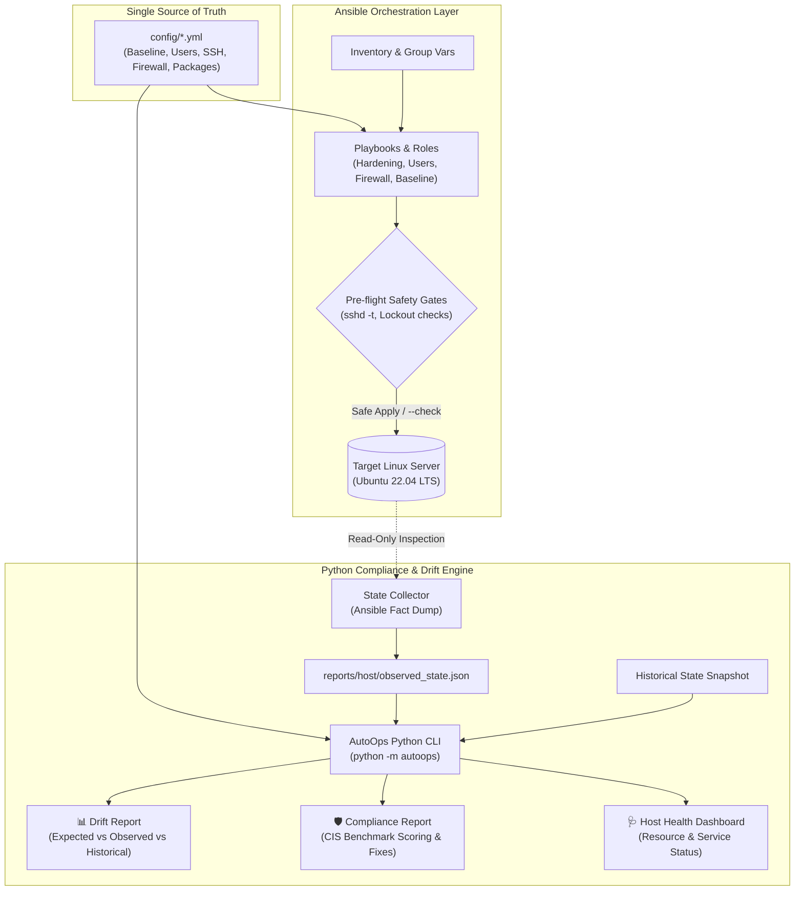

# AutoOps — Infrastructure as Code & Continuous Compliance Platform

[](https://www.python.org/)
[](https://www.ansible.com/)
[](https://ubuntu.com/)
[](tests/)
[](LICENSE)
[](docs/SECURITY.md)

**AutoOps** is an enterprise-grade, safety-first DevOps automation platform that bridges the gap between **Infrastructure as Code (Ansible)** and **Continuous Compliance & Drift Auditing (Python CLI)**. 

Designed for Linux infrastructure (Ubuntu 22.04/Debian), AutoOps enforces declarative baselines, implements fail-safe security hardening (SSH, UFW, file permissions), detects silent configuration drift, and produces actionable compliance audit reports with automated remediation guidance.

---

## 🎯 The Problem AutoOps Solves

In modern production environments:
1. **Configuration Drift:** Systems slowly diverge from their intended state due to ad-hoc emergency fixes, manual package installations, and unrecorded changes.
2. **Lockout Risk during Hardening:** Aggressive SSH hardening or misordered firewall rules frequently lock system administrators out of production instances.
3. **Decoupled Auditing:** Security teams typically use proprietary, heavy scanners that cannot read or validate the infrastructure code used by DevOps engineers.

### How AutoOps Solves This
* **Single Source of Truth:** A unified declarative configuration (`config/*.yml`) is consumed by both the **Ansible provisioning engine** and the **Python auditing CLI**.
* **Zero-Downtime Hardening:** Pre-flight syntax validation (`sshd -t`), reload-not-restart semantics, and dual-confirmation safety gates eliminate server lockouts.
* **Continuous Drift & Compliance Engine:** A standalone Python CLI that audits live infrastructure snapshots against baseline policies, scoring compliance and generating copy-paste remediation commands.

---

## 🏗️ Architecture & Data Flow



---

## ⚡ Core Features

### 1. Robust Infrastructure as Code (Ansible)
* **Modular Roles:** Dedicated roles for `baseline`, `users`, `ssh_hardening`, `firewall`, `packages`, `services`, and `maintenance`.
* **Idempotency by Design:** All tasks are strictly idempotent, ensuring repeated runs maintain convergence without unintended modifications.
* **Safe-by-Default:** Destructive actions (user removal, package purging) require explicit confirmation gates (`autoops_allow_destructive=true` + confirmation token).

### 2. Lockout-Free Security Hardening
* **Fail-Safe SSH Drop-in:** Hardens SSH via modular `/etc/ssh/sshd_config.d/00-autoops.conf` without touching base files.
* **Pre-Flight Validation:** Automatically validates syntax via `sshd -t` prior to reloading the daemon. Automatically rolls back on validation failure.
* **Firewall Precedence:** Enforces an atomic firewall ordering where SSH port access is guaranteed before UFW is activated.

### 3. Continuous Drift Detection Engine
* **3-Way State Reconciliation:** Compares **Desired State** (`config/*.yml`) vs. **Current State** (`observed_state.json`) vs. **Previous Snapshot** (`sample_previous_state.json`).
* Categorizes changes by severity (`CRITICAL`, `HIGH`, `MEDIUM`, `LOW`) with exact diff values and recommended remediation steps.

### 4. CIS-Aligned Compliance Engine
* Evaluates host configuration against automated security checks:
  * Restrictive permissions on sensitive files (`/etc/shadow`, `/etc/ssh/sshd_config`).
  * Insecure service/package auditing (flags `telnet`, verifies `fail2ban` and automatic security updates).
  * SSH daemon configuration (disabling root login, enforcing public-key authentication).
* Outputs compliance percentages and detailed remediation commands.

### 5. Automated Backup & Recovery
* Standalone POSIX backup utility (`scripts/backup_config.sh`) creating timestamped archive bundles with SHA-256 cryptographic verification and tamper detection.

---

## 📁 Repository Structure

```text
autoops/
├── ansible/                        # Infrastructure as Code
│   ├── ansible.cfg                 # Safe defaults, pipelining, host key checking
│   ├── inventory/                  # Inventories & group_vars
│   │   ├── group_vars/all.yml      # Global baseline configuration
│   │   ├── localhost.yml           # Safe local sandbox inventory
│   │   └── development.yml         # Target VM inventory
│   ├── playbooks/                  # Orchestration playbooks (site.yml, security.yml, etc.)
│   ├── roles/                      # Modular Ansible roles
│   │   ├── baseline/               # Timezone, essential packages, base dirs
│   │   ├── users/                  # User accounts, groups, authorized_keys
│   │   ├── ssh_hardening/          # Non-destructive SSH hardening + rollback
│   │   ├── firewall/               # UFW management with SSH-first rule ordering
│   │   ├── packages/               # Package installations, upgrades & auditing
│   │   ├── services/               # Service lifecycle and failure monitoring
│   │   └── maintenance/            # Automated state snapshots & maintenance
│   └── tasks/guard.yml             # Blast-radius safeguard tasks
├── autoops/                        # Core Python CLI & Audit Engine
│   ├── __main__.py                 # CLI entry point (python -m autoops)
│   ├── cli.py                      # Argument parsing & subcommand dispatcher
│   ├── config.py                   # YAML schema loading & validation
│   ├── drift.py                    # 3-way configuration drift analysis engine
│   ├── compliance.py               # CIS-style security benchmark evaluator
│   ├── report.py                   # Host health & metric report generator
│   ├── inventory.py                # Static Ansible inventory parsing & safety auditor
│   ├── validate.py                 # Static schema, syntax & secret scanner
│   └── safeguards.py               # Destructive action verification gates
├── config/                         # Unified Desired State Definitions
│   ├── baseline.yml                # System baseline specifications
│   ├── users.yml                   # User & group policies
│   ├── packages.yml                # Allowed & disallowed package lists
│   ├── services.yml                # Mandatory running & stopped services
│   └── compliance_rules.yml        # Security audit rules and severity weights
├── scripts/                        # Operational scripts
│   ├── backup_config.sh            # SHA-256 verified configuration backup tool
│   ├── windows_validate.ps1        # Full Windows validation pipeline script
│   ├── validate_project.py         # Static analyzer wrapper
│   ├── check_drift.py              # Drift CLI wrapper
│   └── generate_report.py          # Report CLI wrapper
├── tests/                          # Automated Pytest Suite
│   ├── test_config.py              # Schema & inventory validation tests
│   ├── test_drift.py               # Drift detection algorithm tests
│   ├── test_reports.py             # Compliance engine & reporting tests
│   └── test_backup_script.py       # Backup script functionality tests
├── examples/                       # Sample state snapshots for testing & demos
└── docs/                           # Technical documentation & runbooks
    ├── ARCHITECTURE.md             # Deep-dive system architecture
    ├── SECURITY.md                 # Security architecture & safeguards
    ├── OPERATIONS_RUNBOOK.md       # Production operations guide
    └── TROUBLESHOOTING.md          # Diagnostic runbook
```

---

## 🚀 Quick Start Guide

AutoOps supports two operational modes:
1. **Local Developer & Audit Mode (Cross-Platform / Windows / macOS / Linux):** Runs static analysis, security validation, compliance evaluation, and unit tests using Python.
2. **Infrastructure Deployment Mode (Linux / Ansible):** Executes playbooks against target Ubuntu servers.

### Mode 1: Local Developer & Audit Mode

No Linux host, Docker, or Ansible required. Works directly with Python 3.11+.

```bash
# 1. Clone & navigate to repository root
git clone https://github.com/Ayyappanmj/autoops-linux-infrastructure-automation.git
cd autoops-linux-infrastructure-automation

# 2. Set up virtual environment
python -m venv .venv
# On Linux/macOS: source .venv/bin/activate
# On Windows:    .\.venv\Scripts\Activate.ps1

# 3. Install development dependencies
pip install -r requirements-dev.txt

# 4. Run full test suite (66 tests)
pytest -v

# 5. Run static project validation (structure, schemas, secrets)
python -m autoops validate

# 6. Run inventory security check
python -m autoops inventory-check
```

#### Windows 1-Click Validation
On Windows, you can execute the entire pipeline with a single command:
```powershell
powershell -ExecutionPolicy Bypass -File .\scripts\windows_validate.ps1
```

---

### Mode 2: Linux Target Deployment Mode

Requires Ansible 2.15+ on Ubuntu/Debian or WSL2:

```bash
# 1. Install Ansible dependencies & collections
pip install -r requirements-ansible.txt
ansible-galaxy collection install -r ansible/requirements.yml

# 2. Syntax check playbooks
export ANSIBLE_CONFIG="$PWD/ansible/ansible.cfg"
ansible-playbook -i ansible/inventory/development.yml ansible/playbooks/site.yml --syntax-check

# 3. Dry-run simulation (Check Mode — no changes applied)
ansible-playbook -i ansible/inventory/development.yml ansible/playbooks/site.yml --check --diff

# 4. Apply configuration to target host
ansible-playbook -i ansible/inventory/development.yml ansible/playbooks/site.yml
```

---

## 💻 CLI In Action

### 1. Comprehensive System Health Report
```bash
python -m autoops report --demo
```
```text
AutoOps infrastructure health report  [SAMPLE/DEMO DATA - not a live system]
Generated: 2026-11-09T07:41:06+00:00   Data source: SAMPLE/DEMO DATA
------------------------------------------------------------------------------
Hostname : demo-ubuntu-01
OS       : Ubuntu 22.04.4 LTS
CPU      : Demo vCPU @ 2.00GHz (count: 2)
Memory   : 1180 / 3936 MB (30.0%)
Disk     : / 91.2% used
Services : 3 checked, unhealthy: cron
Updates  : 0 pending, reboot required: False
Drift    : DRIFT_DETECTED (21 findings, 0 unverified sections)
Compliance: NON_COMPLIANT 42.1% (8/19 passed, 8 failed, 3 warnings)
WARNING  : disk usage 91.2% >= 80%
```

---

### 2. Configuration Drift Detection
Compares desired configuration against observed server state:
```bash
python -m autoops drift --previous examples/sample_previous_state.json
```
```text
AutoOps drift report
Host: demo-ubuntu-01
Status: DRIFT_DETECTED   Checks: 56   Findings: 21
By severity: critical=2, high=11, medium=7, low=1
------------------------------------------------------------------------------
[CRITICAL] files: /etc/shadow (mode)  (mismatch, expected)
           expected: 0640   actual: 0644
           fix: chmod 640 /etc/shadow

[CRITICAL] firewall: allow 22/tcp  (missing, expected)
           expected: rule present   actual: rule absent
           fix: ufw allow 22/tcp

[HIGH    ] packages: telnetd  (unexpected, expected)
           expected: absent   actual: installed
           fix: Remove telnetd; AutoOps only removes packages with explicit destructive confirmation.

[HIGH    ] ssh: PermitRootLogin  (mismatch, expected)
           expected: no   actual: yes
           fix: Set 'PermitRootLogin no' in /etc/ssh/sshd_config.d/00-autoops.conf
```

---

### 3. Continuous Security Compliance Audit
Evaluates baseline security rules and outputs copy-paste fixes:
```bash
python -m autoops compliance
```
```text
AutoOps compliance report
Host: demo-ubuntu-01
Status: NON_COMPLIANT   Compliance: 42.1%
Total: 19  Passed: 8  Failed: 8  Warnings: 3
------------------------------------------------------------------------------
[FAIL] FILE-001 /etc/shadow is not readable by group/others beyond 0640  (severity: critical)
       found: mode 0644 (max allowed 0640)
       fix:   chmod 0640 /etc/shadow (or run playbooks/baseline.yml).

[FAIL] FW-001   Host firewall is active  (severity: high)
       found: firewall is inactive
       fix:   Allow SSH first, then 'ufw enable' (playbooks/security.yml with firewall_policy.enable=true).

[FAIL] SSH-001  Root SSH login is disabled  (severity: high)
       found: PermitRootLogin = yes
       fix:   Set 'PermitRootLogin no' in /etc/ssh/sshd_config.d/00-autoops.conf

[PASS] FILE-002 sshd_config is not writable by group/others  (severity: high)
[PASS] SSH-004  Empty SSH passwords are rejected  (severity: high)
[PASS] SVC-001  SSH service is running and enabled  (severity: high)
```

---

## 🛡️ Production Safety Design

AutoOps was built with **defense-in-depth and operational safety** as first-class requirements:

| Safety Layer | Implementation | Benefit |
|---|---|---|
| **Lockout Protection** | Drop-in SSH config validated with `sshd -t` before reload | Eliminates syntax-related SSH outages |
| **Atomic Firewall Rule Order** | SSH port 22/tcp rule applied *before* UFW is enabled | Prevents dropping active administrative connections |
| **Two-Man Rule Gates** | Requires `autoops_allow_destructive=true` + confirmation token | Prevents accidental deletion of users or system packages |
| **Non-Destructive Defaults** | Default settings audit and log without modifying state | Safely deployable across brownfield environments |
| **Credential Protection** | Automated static regex scanner in `autoops validate` | Prevents accidental commits of private keys, AWS tokens, or passwords |
| **Predictable Exit Codes** | Standardized UNIX exit codes (`0` = clean, `1` = findings, `2` = error) | Seamless integration into CI/CD quality gates |

---

## 🧪 Testing & Quality Assurance

The codebase maintains rigorous quality standards:
* **Unit Testing:** Comprehensive pytest test suite covering YAML schema validation, drift detection algorithms, compliance evaluators, and safeguard gates.
* **CI/CD Integration:** Automated GitHub Actions matrix testing on both `ubuntu-latest` and `windows-latest`.
* **Static Analysis:** Strict YAML linting, Python AST compilation, and secret pattern matching.

To run tests locally:
```bash
pytest --verbose --cov=autoops
```

---

## 📄 License

This project is licensed under the MIT License — see the [LICENSE](LICENSE) file for details.
